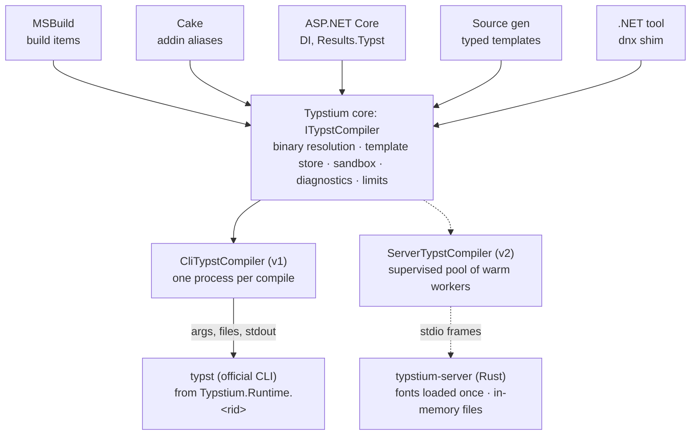

# Typstium — Design Document (working name)

Oct 7, 2026 · Magnus Lindhe

> Living version: https://claude.ai/code/artifact/c418a282-4a89-42af-b444-3c8ac8d336e6

This is the family overview. Each major feature has its own living spec in `docs/specs/`. Where a spec
and this overview disagree, the spec wins.

| Spec | Covers | Status |
| --- | --- | --- |
| [Foundation](specs/foundation.md) | Repo scaffolding, core API, CLI backend, diagnostics, template providers, tests | Draft |
| Runtime packages (`runtime-packages.md`) | `Typstium.Runtime.<rid>`, packaging CI | Planned |
| Build (`build.md`) | `Typstium.Build` for `dotnet build` and `msbuild.exe` | Planned |
| Cake (`cake.md`) | `Cake.Typstium` | Planned |
| ASP.NET Core (`aspnetcore.md`) | `Typstium.AspNetCore`, template lifecycle | Planned |
| Markdown (`markdown.md`) | Markdown and Scriban content on `.typ` layouts via cmarker | Planned |
| Source generators (`source-generators.md`) | Typed templates | Planned |

Spikes: [Spike 0: CLI latency, Markdown, offline packages, diagnostics](spikes/2026-10-07-cli-and-markdown.md).

## Summary and goals

The project brings Typst to every .NET environment through a C# API over the Typst CLI. That covers modern .NET, .NET Framework, MSBuild, Cake and ASP.NET Core. It doesn't use P/Invoke. Typst does the heavy lifting, and the project says so openly. It's a distribution and integration layer, not a separate PDF engine.

**Goals**

- An idiomatic C# API over the Typst CLI, delivered as NuGet packages.
- Typst binaries delivered through NuGet for each platform, with no manual install.
- First-class build-time use: MSBuild items and a Cake addin.
- First-class runtime use: ASP.NET Core on both modern .NET and .NET Framework (the 2.x generation).
- Safe rendering of user-supplied templates.
- A path to high throughput through a long-running server mode, without changing the public API.

**Non-goals for now**

- Native FFI bindings to the Typst Rust crates from .NET.
- Snapshot-testing support (deferred, not rejected).
- Replacing or forking Typst in any way.

**Why the CLI and not FFI**

- Typst has no stable C ABI. FFI bindings would break on every release, while the CLI is the most stable interface Typst offers.
- Process isolation: a Rust panic, a runaway template or a memory spike kills a child process, not the host (for example, w3wp under IIS).
- Timeouts and cancellation are simple: kill the process.
- Licensing is simple: Typst is Apache-2.0, so the binaries can be redistributed with NOTICE and font licenses included.
- Positioning: QuestPDF moved to a commercial license for larger companies, so a free, high-quality PDF engine for .NET has a clear audience.

## Use cases and supported hosts

There's no single primary audience. Two concrete use cases drive the design, and both must work from day one.

**A: Build pipeline (Cake).** Turn the product specification and release notes, written in Markdown plus a Typst template, into a PDF that ships with the installer. Runs on CI agents and needs no network at build time.

**B: Web API (ASP.NET Core).** Given a license ID, render a PDF with the license details from data plus a template. Today the template is hard-coded on disk. License administrators should be able to change the wording without a software release, which makes templates user-supplied content.

| Host | Target framework | Typical use | Notes |
| --- | --- | --- | --- |
| Cake (script and Frosting) | net8.0+ | Use case A | Tool resolution via `#tool`; CLI backend |
| MSBuild (SDK-style projects) | Any | Docs as code | Incremental builds, canonical errors |
| ASP.NET Core on modern .NET | net8.0+ | Use case B | DI, hosted service, server mode later |
| ASP.NET Core 2.x on .NET Framework | net4x via netstandard2.0 | Use case B (legacy) | IIS, app pool recycling, Job Objects |
| Containers (Linux, Alpine) | net8.0+ | Use case B | musl static Typst binaries |
| Command line (`dnx` / global tool) | net10.0 | Ad hoc | Thin shim over the bundled binary |

## Naming

**Working name: Typstium.** TypstSharpie is the close second. The decision is still open. The rule is that the name must contain "Typst": the project brings Typst to .NET and shouldn't pose as its own engine.

| Candidate | Impression | Verdict |
| --- | --- | --- |
| Typstium | "-ium" reads as a distribution or runtime (Chromium), which fits "Typst packaged for .NET" | Strongest |
| TypstSharpie | Pen pun on Typst/typist; honest, fun, and splits into searchable tokens | Close second |
| Typster | Warm, echoes "typist"; no hint of .NET or packaging; check that it isn't taken | Good, generic |
| Typstify | "-ify" suggests a converter or hosted service | Misleading |
| Typstra | Reads as a separate, possibly official, product | Weakest |

Considerations before deciding:

- **NuGet search.** NuGet appears to split PascalCase IDs into tokens, so `TypstSharpie` matches a search for "typst" by ID. `Typstium` is one token and relies on tags and the description. Verify by publishing a test package.
- **Trademarks.** Sharpie is a registered trademark of Newell Brands. "Typst" belongs to Typst GmbH, so ask the Typst team (forum or Discord) for a nod before publishing.
- **Reserve the NuGet ID prefix** as soon as the name is chosen.
- **Cake convention.** The addin must be named `Cake.<Name>`.

Rejected brand-only names (Platen, Carriage, Galley, Nib, Steno and others) hide Typst, which goes against the rule above.

## Architecture overview

Everything is built on one abstraction, `ITypstCompiler`. Its first implementation runs the official CLI once per call. A warm server backend can be added later without breaking callers. Integrations (MSBuild, Cake, ASP.NET Core, source generators) depend only on the core API, never on a specific backend.



Integrations sit on the core API only. Swapping the CLI backend for the server backend changes nothing above the core. Dashed = v2 server mode, gated on measured CLI latency.

**Backends**

1. `CliTypstCompiler` (v1): one process per compile, using the official Typst binaries. Default for build-time use and low-volume web use.
2. `ServerTypstCompiler` (v2): a pool of long-running Rust sidecar processes reached over stdio. For throughput (see Server mode).
3. Possible later: an in-process native or WASM backend. Not planned, but the interface leaves room for it.

**Package map**

| Package | Purpose | Phase |
| --- | --- | --- |
| `Typstium` | Core API (`netstandard2.0` + `net8.0`), CLI backend, binary resolution, template store abstraction | v1 |
| `Typstium.Runtime.<rid>` | Official Typst CLI binary for one platform, copied to output by build targets | v1 |
| `Typstium.Runtime.All` | Meta package referencing every RID package (large) | v1 |
| `Typstium.Build` | MSBuild items and targets: incremental compile, canonical errors, package vendoring | v1 |
| `Cake.Typstium` | Cake addin over the core API | v1 |
| `Typstium.AspNetCore` | DI registration, options, hosted service, health checks, `Results.Typst(...)` | v1 |
| `Typstium.SourceGenerators` | Strongly typed template classes generated from `.typ` files | v1.x |
| `Typstium.Tool` | `dnx` / global tool shim over the bundled binary | v1.x |
| `Typstium.Server.<rid>` | Rust sidecar binaries plus `ServerTypstCompiler` | v2 |
| `Typstium.Verify` | Snapshot testing of rendered output | Deferred |
| `Typstium.Extensions.FileProviders` | `ITemplateProvider` adapter over `Microsoft.Extensions.FileProviders.IFileProvider` | Later |

## Binary distribution

Binaries are copied by our own `buildTransitive` targets to a fixed output folder, `typst/<rid>/typst(.exe)`. We don't rely on NuGet's `runtimes/<rid>/native` mechanism, which is unreliable for executables and on .NET Framework (packages.config, AnyCPU, RID defaults).

**Host binary vs target binary**

- Build tooling (MSBuild, Cake) needs a binary for the machine doing the build.
- The runtime needs a binary for the machine running the app. These differ when building on Windows and deploying to a Linux container.
- `Typstium.Build` therefore bundles or resolves host binaries independently, following the `Grpc.Tools` precedent.

**Per-RID packages**

- One package per platform: win-x64, win-arm64, linux-x64, linux-arm64, osx-x64, osx-arm64. Confirm against the targets of each Typst release.
- Typst's Linux releases are static musl builds, so one binary should serve both `linux-x64` and `linux-musl-x64`. Verify per release.
- Each binary is tens of MB because fonts are embedded. `Runtime.All` will be roughly 150–250 MB, so it's offered but not the default.

**Known gotchas**

- NuGet extraction drops the Unix executable bit. Run `chmod +x` in the build targets and before first launch at runtime.
- Single-file publish can't run an exe from inside the bundle. The binary must sit next to the app; document this and handle it in the targets.
- Verify SHA256 checksums of the GitHub release assets in the packaging CI, and sign the packages.

**Binary resolution chain (at runtime)**

1. Explicit path in options
2. `TYPST_PATH` environment variable
3. Bundled runtime package (`typst/<rid>/` next to the app)
4. `typst` on `PATH`
5. Optional download on first use, Playwright-style, pinned and checksum-verified

**Versioning**

- Runtime packages follow Typst's version, e.g. `Typstium.Runtime.win-x64` 0.14.0.
- The core library has its own semver and a declared minimum supported Typst version.
- At startup the core library runs `typst --version` once and gates features on the result (PDF/A, PDF/UA, HTML export, deps output format). Users can upgrade Typst without waiting for a wrapper release.

## Core API design

The core API is async, takes a `CancellationToken`, and is built on streams. It targets `netstandard2.0` and `net8.0`, with polyfills on .NET Framework for `WaitForExitAsync` and process-tree kill. Data always goes in as JSON, never through string interpolation.

**Principles**

- **Data as JSON, never interpolated markup.** Building Typst source with `$"..."` is the Typst equivalent of SQL injection. Data goes in through `--input` or a generated `data.json`, and the template reads it with `json(...)`. A `TypstEscape` helper exists for people who must interpolate.
- **Virtual files instead of temp dirs.** `.WithFile("logo.png", stream)` and `.WithData("data.json", model)` materialize a per-compile sandbox `--root` and clean it up afterwards. The server backend keeps everything in memory.
- **stdin/stdout where possible.** The CLI accepts `-` for input and output.
- **Font control.** Expose `--font-path` and `--ignore-system-fonts`. Scanning system fonts on every call is a major per-call cost and makes output differ between machines.
- **Offline and reproducible output.** Expose package path and cache settings. Set a fixed creation timestamp (`SOURCE_DATE_EPOCH`) so builds are byte-identical.
- **Structured diagnostics.** Parse `--diagnostic-format short` into `TypstDiagnostic { File, Line, Column, Severity, Message }`.
- **Resource limits.** Timeout, cancellation that kills the process tree, and a maximum output size.
- **Output formats.** PDF (with PDF/A and PDF/UA standards), PNG, SVG, and HTML once it stabilizes. `typst query` is exposed for metadata extraction.

**Sketch of intended usage** (illustrative, not final):

```csharp
var pdf = await typst
    .FromTemplate("license.typ")
    .WithData("data.json", licenseViewModel)
    .WithFile("logo.png", logoStream)
    .WithFonts("fonts/", ignoreSystemFonts: true)
    .ToPdf(PdfStandard.A2b)
    .CompileAsync(timeout: TimeSpan.FromSeconds(10), ct);

if (!pdf.Success)
    foreach (var d in pdf.Diagnostics) log.LogError("{File}({Line},{Col}): {Msg}", d.File, d.Line, d.Column, d.Message);
```

## User-supplied templates

User-supplied templates are a must (use case B), so the template is a security boundary. Typst is a good base: it can't run shell commands, and file access is confined to `--root`. The library enforces the rest.

**Security model**

| Threat | Mitigation |
| --- | --- |
| Template reads app files (`read("../appsettings.json")`) | A per-render sandbox root holding only the template, its assets and the data. Never the app directory. |
| Template prints sensitive data | Pass a purpose-built view model, never the full entity. Whatever the template receives, it can print. |
| Network access via `@preview/...` package imports | Pre-vendor allowed packages and point the package path at them. Check whether the CLI has a true offline switch; the server backend resolves packages only from an allow-list. |
| Denial of service (`while true {}`, huge documents) | Wall-clock timeout, memory cap (Job Object on Windows, cgroups in containers), maximum output size. |
| Orphaned processes after a crash or recycle | Job Object with kill-on-close on Windows; the server exits on stdin EOF. |

**Template lifecycle**

- `ITemplateStore` abstraction with file system, database and blob implementations.
- Draft and published versions per template.
- Validation before publishing: compile against stored sample data and reject on errors or a timeout.
- If a published template fails at render time, fall back to the last known-good version and log the failure.
- Optional preview endpoint so administrators see the PDF before publishing.

## Server mode (v2)

Server mode is feasible, but it needs our own small Rust sidecar because the stock Typst CLI has no server mode. `typst watch` keeps caches warm, but driving it through file writes and polling is fragile and serial, so we won't build on it.

**The sidecar: `typstium-server`**

- Built on the `typst` crate plus `typst-kit` for fonts and packages.
- Long-lived. Loads fonts once and keeps the comemo cache warm across compiles.
- Serves requests in parallel on worker threads, with an in-memory virtual file system and no temp files.
- Package resolution only from an allow-listed vendored directory, so no network.
- Exits when stdin reaches EOF, so it never outlives its parent.

**Transport: stdio, not sockets or named pipes**

- No ports, no firewall rules, no authentication: only the parent holds the pipe.
- Behaves the same in IIS, containers, App Service and Cake.
- Precedent: the LSP model. MSBuild nodes and Roslyn's compiler server work on the same principle.

**Protocol sketch:** length-prefixed frames carrying a JSON header plus binary payloads (MessagePack is an alternative).

```text
-> Compile { id, main, files: { path: bytes }, inputs, format, options }
<- Result  { id, ok, diagnostics[], output: bytes | pages[] }
-> Ping / <- Pong        health check
-> Shutdown              graceful stop
```

**.NET side: a supervised pool (`TypstServerPool`)**

- Lazy start plus a warm-up compile.
- N workers, configurable (default about half the cores).
- Health pings. A crashed worker restarts with backoff.
- Workers recycle after N compiles or past a memory threshold, because comemo caches grow.
- A compile can't be interrupted mid-flight, so a timeout kills that worker. Other requests that were in flight on it are retried on a fresh worker.
- On Windows, workers run in a Job Object with kill-on-close, which covers IIS app pool recycles.

**Hosting integration**

- ASP.NET Core: the pool is a singleton, with an `IHostedService` for warm-up and graceful shutdown and an `IHealthCheck`. These APIs exist in the 2.1 generation too, so this works on .NET Framework.
- Cake and MSBuild default to the CLI backend. A warm server only pays off for large batches.

**Costs and the gate before building it**

- We would own a Rust project, cross-compile about 6 targets in CI (cargo-zigbuild) and track `typst` crate API changes each release.
- The official CLI backend stays as the fallback and for plain-upstream users.
- **Gate:** first measure CLI latency on the real license template, with and without `--ignore-system-fonts` and bundled fonts. If it's acceptable for actual volumes, server mode stays v2.

## Integrations

Every integration is a thin layer over the core API. All of them stay in scope except snapshot testing, which is deferred.

**MSBuild (`Typstium.Build`)**

- Items: `<TypstDocument Include="docs/**/*.typ" OutputFormat="pdf" />`. Outputs can be added as `EmbeddedResource`, `Content` or copy-to-output.
- Incremental builds use Typst's dependency output (`--make-deps`, or the newer deps flag depending on version) for real Inputs/Outputs.
- Diagnostics are converted to canonical `file(line,col): error TYPST0001: msg`, so they're clickable in the VS and Rider Error List.
- A package vendoring target pre-downloads allowed `@preview/...` packages so builds run offline.

**Cake (`Cake.Typstium`)**

- Aliases such as `TypstCompile("spec.typ", settings)`, for both script and Frosting.
- The binary resolves the Cake way first (`#tool nuget:?package=Typstium.Runtime.win-x64`), then through the core resolution chain.
- Use case A: Markdown release notes are rendered inside a branded `.typ` template with the Typst package `cmarker`, vendored at build time.

**ASP.NET Core (`Typstium.AspNetCore`)**

- `services.AddTypst(options => ...)` registers backend selection, fonts, template store and concurrency limits (a `SemaphoreSlim` cap for the CLI backend).
- `Results.Typst("license.typ", model)` returns `application/pdf` in minimal APIs, with an MVC equivalent.
- Hosted service for warm-up and an `IHealthCheck`.
- Works on ASP.NET Core 2.x on .NET Framework through the `netstandard2.0` build.

**Typed templates (`Typstium.SourceGenerators`)**

- A `.typ` template declares its inputs, either as a JSON schema next to the file or by convention.
- The generator emits strongly typed classes, e.g. `LicenseTemplate.RenderPdfAsync(LicenseModel model)`, so data mismatches fail at compile time.
- This is the project's biggest differentiator.

**.NET tool (`Typstium.Tool`)**

- A thin AOT shim that runs the bundled binary, so `dnx typst compile x.typ` works with zero setup.
- Uses the RID-specific tool packages supported in .NET 10.

**Deferred: snapshot testing (`Typstium.Verify`)**

- Render to PNG and diff against approved images using Verify. Not needed now; revisit after v1.

## Roadmap, open questions and next steps

The first milestone is a spike that proves both use cases on the CLI backend. Server mode is gated on measured latency.

**Phases**

1. **Spike:** CLI wrapper prototype, latency measurement on the real license template, Cake build of one release-notes PDF.
2. **v1:** core API, runtime packages, `Typstium.Build`, `Cake.Typstium`, `Typstium.AspNetCore`, template store and sandboxing.
3. **v1.x:** source generators for typed templates, `Typstium.Tool`.
4. **v2:** Rust sidecar and `ServerTypstCompiler`, if the spike's measurements call for it.
5. **Later:** `Typstium.Verify`, an in-process native or WASM backend, `Typstium.Extensions.FileProviders`.
6. **Later, build infrastructure:** orchestrate CI with Cake (Frosting or the Cake SDK), using
   `Cake.Download.Module` to fetch and checksum-verify Typst release assets for the runtime packages and to
   vendor Typst packages such as cmarker.

**Open questions**

- Final name: Typstium or TypstSharpie?
- Does NuGet search find a single-token name like `Typstium` when searching "typst"?
- ~~Does the current Typst CLI have a true offline switch for package downloads?~~ No; see spike 0
  (vendored `--package-path` plus a dead proxy).
- ~~Which RIDs does each Typst release ship, and does the musl binary run on glibc distros without
  problems?~~ Seven RIDs for 0.15.1; the static musl build runs on glibc (Ubuntu 24.04). See spike 0.
- How should a template declare its input schema for the source generator: a JSON schema file or a Typst convention?
- Wire format for the sidecar: JSON plus binary frames, or MessagePack?

**Next steps**

- [ ] Pick the name and reserve the NuGet ID prefix
- [ ] Ask the Typst team for a nod on using the name
- [ ] Spike: measure CLI compile time for the license template (default vs `--ignore-system-fonts` + bundled fonts)
- [ ] Spike: produce the release-notes PDF from Markdown with `cmarker` in a Cake script
- [ ] Prototype the build targets that copy the binary and set the executable bit
- [ ] Verify the `buildTransitive` approach in an ASP.NET Core 2.x app on .NET Framework under IIS
